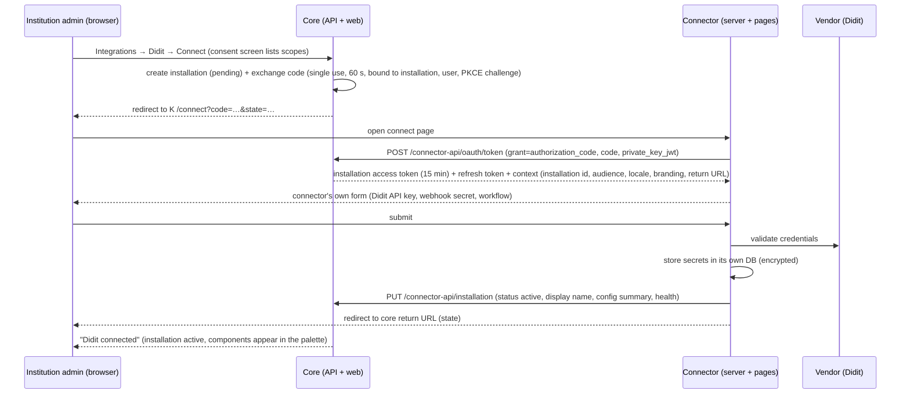

# 03 — Integrations: connectors as independent services

Supersedes the "connectors inside the core" design of [../architecture/integrations.md](../architecture/integrations.md)
(concepts kept: connector, connection, component; what changes is where connectors run and who owns their data).

## Principles

1. **The core owns the domain**: institutions, people, cases, tasks, decisions, documents, audit. It defines
   **canonical entities** (a verification result, a signature request, a document, an account, a transaction, a
   message) and their events.
2. **A connector owns a vendor**: its own server, frontend, database, secrets, migrations and docs. It translates
   between the vendor and the core's canonical entities. The core never stores vendor credentials.
3. **A manifest is the contract**: the core learns everything about a connector (URLs, auth, components, events,
   scopes, UI entry points) from a versioned manifest kept in a registry. No connector-specific code in the core.
4. **Least privilege both ways**: a connector gets an installation-scoped token with the scopes the installer
   approved; the core calls a connector with short-lived signed requests; egress only to manifest-declared hosts.
5. **Everything async is durable**: calls to connectors run inside Restate steps (retries, idempotency keys); callbacks
   resolve durable promises.

This is the model used by Atlassian Connect (app descriptor + JWT + lifecycle webhooks), Slack and Shopify apps (OAuth
install, signed requests, embedded UI with session tokens), Stripe Apps and Microsoft Teams (manifests), Zapier/n8n
(actions, triggers, dynamic fields) and unified APIs such as Merge/Nango (canonical models per category).

## Trust model (decided: first-party only at first)

Only connectors we build and operate are registered. Consequences:

- Registration is an internal release step (the connector's CI publishes its manifest; a platform admin approves the
  version in the console). No publisher programme, partner review, listing pages or revenue share yet.
- First-party connectors run in our infrastructure (same cluster/network as the core, separate services and
  databases), so core → connector traffic can stay private; requests are still signed (the protocol does not change
  when third parties arrive).
- Everything a third party would need later is already in the contract: manifest, scopes and consent, signed requests,
  installation tokens, lifecycle events, egress declaration. Opening up later adds: publisher accounts, automated and
  manual manifest review, security questionnaire, sandboxed hosting option, per-publisher rate limits, and a
  marketplace listing.

## Where vendor secrets live (decided: in each connector)

Two industry patterns exist, and they depend on who runs the integration code:

| Pattern | Who uses it | Fits when |
| --- | --- | --- |
| **App-owned credentials**: each app/integration stores its own vendor tokens and secrets in its own database | Slack apps, Shopify apps, Atlassian Connect/Forge apps, Stripe Apps, Microsoft Teams apps | integrations are **separate services** (possibly by other parties) that the platform calls through a contract |
| **Central credential vault**: the platform stores every connection's credentials and injects them into integration code at run time | Zapier, Make, n8n, Retool, Nango, Merge, Airbyte | the platform **runs the integration code itself** (nodes/actions inside its own runtime) |

Our connectors are separate services with their own servers and databases, so **app-owned credentials is the standard
choice** here, and it keeps the core free of vendor secrets (smaller blast radius: a core breach exposes no KYC or
e-signature keys). The trade-off is consistency: N connectors must each handle secrets correctly. Guard-rails:

1. The SDK's `SecretStore` is the only way to store secrets: envelope encryption (AES-256-GCM data keys wrapped by a
   **per-connector** key-encryption key: `CONNECTOR_KEK` locally, a KMS key per connector in production), secrets
   never returned by any endpoint (write-only forms: "•••• set 2 days ago, replace"), never logged (SDK logger redacts).
2. Rotation: the setup UI supports replacing secrets; the SDK supports re-wrapping data keys when the KEK rotates.
3. Deletion: on `uninstalled`/`tenant.deleted`, secrets are deleted at once (crypto-shredding: delete the data key).
4. Audit: the connector reports "secret set/rotated/deleted" (never the value) to the core audit through the connector
   API, so the institution's audit log shows it.
5. A shared checklist and an SDK test asserting no secret appears in responses or logs, run in every connector's CI.

If we ever need a central vault (e.g. many tiny connectors, or institutions asking for one place to rotate everything),
the SDK `SecretStore` interface can be backed by a central secrets service instead of the connector's database without
changing connector code.

## Vocabulary

| Term | Meaning | Example |
| --- | --- | --- |
| **Connector** | a deployable service integrating one vendor/system, published by us (later partners) | `didit`, `documenso`, `smtp-mailer`, `postgres-datasource`, `gmail` |
| **Manifest** | JSON document describing a connector version | `integrations/didit/manifest.json` |
| **Registry** | the core's catalogue of approved connector versions (platform staff manage it) | `connectors`, `connector_versions` tables |
| **Audience** | who may install a connector | `platform` (staff), `tenant` (institution), `client` (end user, e.g. their bank account for open banking, their mailbox) |
| **Installation** (= connection) | a connector installed by an audience principal, with its own configuration in the connector | "Didit – production workflow", "Gmail of client X" |
| **Component** | something an installation adds to the core: workflow **actions**, **triggers**, **client steps**, **data sources**, **UI extensions** | `didit.kyc.verify`, `documenso.signature.request` |

## Repository layout

```
packages/
  connector-sdk/            @repo/connector-sdk: manifest types + JSON Schema, server kit (verify core requests,
                            redeem exchange codes, installation tokens, typed core client, define actions/triggers,
                            async completion, events, webhooks helpers, idempotency), UI bridge (embedded pages),
                            test kit (a fake core), CLI: `fintivio-connector validate|dev|register`
integrations/
  didit/                    server (Bun + Hono), web (Vite React, its own pages), db (Drizzle + migrations, own
  documenso/                database), manifest.json, docs/ (README, configuration, data handling), tests/
  smtp-mailer/
  postgres-datasource/
  ...
fake-services/              vendors we cannot reach: same APIs, a control API and a small UI to drive outcomes
  didit/  documenso/  mailbox/  webhook-receiver/  workos/  idp-oidc/  idp-saml/  core-banking-api/  open-banking/  screening/
apps/core                   registry, installations, connector API, engine steps calling connectors
apps/web                    integrations catalogue, install/setup host pages, palette entries, client steps in the portal
```

Each connector is a separate package with its own `dev` task; locally it gets its own Postgres **database and role**
on the embedded instance (e.g. `connector_didit`), its own port and host name (`didit.connectors.localhost:4101`).
Connectors must not share databases with the core or with each other.

## The manifest

```jsonc
{
  "$schema": "https://fintivio.dev/schemas/connector-manifest/1.json",
  "id": "didit",                                  // stable, globally unique
  "version": "1.2.0",                             // semver; the registry pins versions
  "name": "Didit identity verification",
  "publisher": { "name": "Fintivio", "url": "https://fintivio.dev", "support": "support@lintelia.example" },
  "categories": ["identity_verification"],
  "audiences": ["tenant"],                        // platform | tenant | client
  "baseUrl": "https://didit.connectors.fintivio.dev",
  "auth": {                                       // how the connector authenticates to the core
    "clientId": "conn_didit",                     // issued at registration; key material in the registry
    "jwksUrl": "/.well-known/jwks.json"           // connector's public keys (private_key_jwt)
  },
  "scopes": [                                     // what an installation may do in the core (shown at install)
    "clients:read_basic", "cases:read_refs", "verifications:write", "documents:write", "events:publish"
  ],
  "lifecycle": {                                  // core → connector notifications (signed)
    "url": "/lifecycle", "events": ["installed", "uninstalled", "enabled", "disabled", "tenant.suspended", "data.erasure_requested"]
  },
  "ui": {
    "connect": { "url": "/connect", "mode": "redirect" },   // first-time connection: exchange code in the URL
    "setup":   { "url": "/setup",   "mode": "embedded" },   // settings of an existing installation, iframed in the core UI
    "docs":    { "url": "/docs" }
  },
  "components": [
    {
      "kind": "client_step",                      // action that needs the client (the portal shows the step)
      "key": "kyc.verify", "version": 1,
      "title": "Verify identity (document + liveness)", "icon": "/icons/kyc.svg",
      "configSchema": { "type": "object", "properties": { "didit_workflow": { "type": "string", "x-options": "/options/workflows" } } },
      "inputSchema":  { "type": "object", "required": ["person"], "properties": { "person": { "$ref": "fintivio:person" } } },
      "outputSchema": { "$ref": "fintivio:verification" },
      "events": ["approved", "declined", "in_review", "expired"],
      "invoke": { "url": "/actions/kyc.verify", "mode": "async", "timeout": "P7D" },
      "dataClasses": ["identity_document", "biometric"]
    }
  ],
  "triggers": [
    { "key": "verification.expired", "title": "Verification expired", "payloadSchema": { "$ref": "fintivio:verification" } }
  ],
  "webhooks": { "inbound": "/webhooks/didit" },   // vendor → connector (documented; the core never receives them)
  "egress": ["verification.didit.me", "apx.didit.me"],
  "dataHandling": { "stores": ["vendor session ids", "decision payloads"], "retention": "P90D", "regions": ["eu"] }
}
```

- Schema: a JSON Schema for the manifest lives in the SDK; `fintivio-connector validate` runs it and lints (unique
  keys, reachable URLs, schemas compile, events non-empty…).
- `$ref: "fintivio:*"` references the **canonical entity schemas** published by the core (below).
- `x-options` declares **dynamic options** (the Zapier "dynamic fields"/n8n "loadOptions" pattern): the editor asks the
  connector (through the core) for e.g. the list of Didit workflows or Documenso templates of that installation.

## Registry (core, platform-owned)

- Tables (platform connection, `fintivio_platform`): `connectors(id, name, publisher, status)`,
  `connector_versions(connector_id, version, manifest jsonb, manifest_hash, status: draft|approved|deprecated|revoked,
  approved_by, approved_at)`, `connector_credentials(connector_id, client_id, jwks_url | public_jwk, created_at)`.
- Registration: `POST /platform/connectors { manifestUrl }` (`platform.connectors:manage`) fetches
  `${baseUrl}/.well-known/fintivio-connector.json`, validates, stores a **draft** version; a platform admin approves it
  (first-party: part of the release; the review of scopes, egress and data classes becomes mandatory with third parties).
  Locally the stack registers and approves every connector in `integrations/*` automatically (08). Updates are new versions; installations move to a new version
  explicitly (minor/patch auto-upgrade optional; major requires re-consent when scopes grow).
- Revocation disables every installation at once (kill switch) and is audited on the platform log.

## Installations (core, tenant-owned, RLS)

`connector_installations(id, tenant_id, connector_id, version, audience, owner_type, owner_id, display_name, status:
pending|active|failing|disabled, granted_scopes, config_summary jsonb (non-secret, published by the connector),
created_by, created_at)`. Client-level installations (audience `client`) carry `owner_id` = the client and are visible
only to that client and to workflows of their cases that they consented to.

## Connect flow (first time)



- The exchange code is the OAuth 2.0 authorization code pattern with the connector as a confidential client
  (`private_key_jwt`, RFC 7523) and PKCE; tokens are audience-restricted (`aud` = the connector), carry
  `installation_id` and the granted scopes, and are rotated (refresh tokens with reuse detection, as for sessions).
- **Setup flow** (already connected): the core's *Integrations → Didit → Settings* page renders the manifest's
  `ui.setup.url` in an iframe (`mode: embedded`) or navigates to it (`mode: redirect`).
  - Embedded pages use the SDK's **UI bridge**: a `postMessage` handshake with the core page gives them a short-lived
    **session token** (JWT signed by the core, `aud` = connector, `installation_id`, user, permissions relevant to the
    connector) that their backend verifies with the core's JWKS — Shopify App Bridge's session-token model; no
    cookies across origins.
  - The core page sets CSP `frame-src` to the connector's origin; connector pages set `frame-ancestors` to the core's
    origins (from their config). The bridge also handles resize, navigation, toasts and "close".
- Disconnect: `DELETE /integrations/:id` → core marks disabled, sends `uninstalled` lifecycle event; connector deletes
  secrets and data per its retention policy and confirms.

## Core ⇄ connector protocol

| Direction | Mechanism |
| --- | --- |
| core → connector (actions, options, lifecycle) | HTTPS POST with a JWT `Authorization: Bearer` signed by the core (EdDSA, core JWKS at `/.well-known/jwks.json`), `aud` = connector id, `exp` ≤ 60 s, `jti`, `installation_id`, and a body hash claim (or RFC 9421 HTTP Message Signatures); `Idempotency-Key` = execution id + step id + attempt-stable key |
| connector → core (results, entities, events) | installation access token (OAuth 2.0) on the **connector API** (`/connector-api/*`), scopes enforced per route |
| vendor → connector | vendor's own webhook verification (HMAC etc.), stored in the connector's inbox table, acknowledged fast |

### Actions

- **sync**: the connector answers `200 { outcome, output }` within the timeout (≤ 30 s). Used for lookups (core banking
  customer by id), sending an e-mail.
- **async**: `202 { ref }`; the core's step waits on a Restate **awakeable** whose id is sent in the request
  (`callback: { url, token }`); the connector later calls `POST /connector-api/executions/{callbackToken}/complete
  { outcome, output }` (or `/fail`). Timeout per component (`invoke.timeout`) maps to the step's timer; expiry emits
  the `expired` event. Used for KYC, e-signature, screening.
- **client_step**: async action that needs the client. The connector's response includes
  `clientAction: { type: 'redirect' | 'embed' | 'sdk', url, title, instructions }`; the core creates a **client task**
  (like today's client requests) and the portal renders it (embed = iframe with the UI bridge, sdk = a known vendor
  SDK such as Didit's web SDK launched by the portal with the returned URL). Completion arrives through the async
  callback, not from the browser.
- Output validation: the core validates `output` against `outputSchema` before storing it in `steps.<id>`; canonical
  entities referenced in the output (a verification) are written through the entity API first and referenced by id.

### Triggers and events

- Connectors publish events with `POST /connector-api/events` (CloudEvents 1.0 envelope: `id`, `source` =
  `connector/didit/<installation>`, `type` = `didit.verification.expired`, `subject`, `data`). The core dedupes by `id`,
  audits, and `EventsService` starts workflows whose `startOn` lists `connector:didit/verification.expired`, or resumes
  waiting steps.
- Polling connectors (systems without webhooks) poll from their own scheduler; the core stays push-only.

### Lifecycle events (core → connector)

`installed`, `uninstalled`, `enabled`, `disabled`, `version.upgraded`, `tenant.suspended`, `tenant.deleted`,
`data.erasure_requested` (a client's erasure request fans out to every connector holding that client's data; the
data-request is only completed when all connectors confirm — ties into CMP-03), `data.export_requested`.

## Canonical entities (core concepts connectors feed)

| Entity | Produced by | Core uses |
| --- | --- | --- |
| `person` / `organisation` (parties) | forms, connectors (core banking lookup) | cases, parties (06) |
| `verification` (kind: identity, document, liveness, address, business; status; risk signals; vendor ref; evidence document ids) | Didit, future KYC/KYB vendors | case page, review context, decisions, audit |
| `screening_result` (sanctions/PEP/adverse media hits with adjudication state) | screening connectors | CMP-01 adjudication tasks |
| `signature_request` (signers, status, signed document id) | Documenso | CLI-06, case documents |
| `document` (file + type + source) | uploads (07), connectors (signed PDFs, ID images) | case documents, evidence export |
| `account`, `transaction` | core banking, open banking | affordability, monitoring, suspicious activity triggers |
| `message` (e-mail/SMS sent, delivery status) | mailer/SMS connectors | timeline, client communications |

- Schemas versioned in `packages/fintivio` (JSON Schema), exposed at `GET /connector-api/schemas/*`.
- Entity API: `POST /connector-api/entities/{type}` (scoped: `verifications:write`, …), idempotent on
  `(installation, external_ref)`; updates append history; the core audits every write with actor
  `connector:<id>/<installation>`.
- The case UI renders canonical entities generically (a verification card shows status, checks and evidence) with an
  optional connector-provided "details" UI extension (iframe) for vendor-specific data.

## Built-in vs connector

Stay in the core: case engine steps (review, conditions, calculate, decisions, tasks, client requests, forms), the
platform mailer used for system e-mails (sign-in codes, invitations), storage, audit. Everything that talks to a third
party becomes a connector, including the institution's own SMTP (`smtp-mailer`), data sources (`postgres-datasource`,
`rest-api`), KYC, e-signature, screening, open banking, Gmail/Outlook (client or tenant audience).

## SDK (`packages/connector-sdk`)

```ts
import { createConnector, defineAction } from '@repo/connector-sdk/server';

const connector = createConnector({ manifest, db, secrets: kek });           // verifies core JWTs, exposes lifecycle
connector.action(defineAction({
  key: 'kyc.verify', input: PersonInput, output: Verification,               // zod → JSON Schema in the manifest
  async invoke({ input, config, installation, callback, idempotencyKey }) {
    const session = await didit(installation).createSession({ vendorData: callback.ref, person: input.person });
    await installation.store.put(session.id, { callback });                  // connector's own DB
    return connector.clientStep({ type: 'sdk', sdk: 'didit-web', url: session.url });
  },
}));
connector.webhook('/webhooks/didit', verifyDiditSignature, async (event, ctx) => {
  const { callback } = await ctx.store.get(event.session_id);
  const verification = await ctx.core.entities.upsert('verification', mapDecision(event));
  await ctx.core.executions.complete(callback, { outcome: mapOutcome(event.status), output: { verificationId: verification.id } });
});
```

Also: typed core client (entities, events, installation, files), token cache and refresh, idempotency store, inbox
table helper for vendor webhooks, health endpoint, structured logging with correlation ids, the UI bridge for pages,
and a **test kit** (`@repo/connector-sdk/testing`): an in-process fake core that registers the manifest, issues
exchange codes and records completions/entities — so each connector is tested without the real core.

## Security requirements

- Registry approval by staff; manifests are hashed and pinned; egress from the core only to `baseUrl` hosts; SSRF
  protection on any URL the core fetches (no private ranges except allow-listed local development).
- Scopes shown at install (consent), stored on the installation, enforced on every connector API call; a version
  asking for more scopes requires re-consent.
- Core request signing keys rotated via JWKS; connectors' keys via their JWKS (`private_key_jwt`).
- Connector databases: encryption at rest, vendor secrets encrypted with a key from the connector's own KMS key
  (envelope encryption), backups, retention per `dataHandling`; subject to the same audits as the core (DORA ICT
  third-party register lists each vendor behind each connector).
- Data minimisation: action inputs are only the mapped fields; the journal stores connector outputs, so outputs carry
  references (entity ids), not raw vendor payloads.
- Tenant isolation in connectors: keyed by `installation_id`; the core never sends its tenant ids (pairwise opaque ids).
- Observability: every call carries a trace id (W3C `traceparent`); the core shows per-installation health, error rate
  and last errors in *Integrations*.

## Core API additions

| Route | Who |
| --- | --- |
| `GET /integrations/catalog` | `integrations:read`: approved connectors for the tenant audience |
| `POST /integrations/:connectorId/install` → `{ redirectUrl }` | `integrations:manage` |
| `GET /integrations`, `GET /integrations/:id`, `DELETE /integrations/:id`, `POST /integrations/:id/setup-session` | `integrations:read/manage` |
| `GET /integrations/:id/options/:component/:field` (dynamic options, proxied to the connector) | `workflows:manage` |
| `/connector-api/oauth/token`, `/installation`, `/executions/*`, `/entities/*`, `/events`, `/files`, `/schemas/*` | connectors (installation tokens) |
| `/platform/connectors*` | `platform.connectors:manage` |
| `GET /.well-known/jwks.json` | public |

## First connectors (in order)

1. `smtp-mailer` (tenant): send through the institution's SMTP; proves sync actions, setup UI, secrets in the
   connector, `message` entities; fake: `fake-services/mailbox`.
2. `postgres-datasource` (tenant): parameterised read-only queries against the institution's database (replaces the
   planned in-core data source; flows INT-01/02/03, SCN-04).
3. `didit` (tenant) and `documenso` (tenant): see [05](05-didit-and-documenso.md).
4. Later: `rest-api`, `screening`, `open-banking` (client audience: the client connects their bank account),
   `gmail`/`outlook` (client or tenant audience).

## e2e

- New flows **CON-01 Connect a connector** (consent, connector pages, active installation, components in the palette),
  **CON-02 Use a connector step in a workflow** (sync and async), **CON-03 Disconnect** (components disappear; published
  workflows using them fail validation/show warnings; lifecycle event received), **CON-04 Staff register and revoke a
  connector version**, **CON-05 Erasure fans out to connectors**.
- Existing INT-* flows are re-pointed to the `postgres-datasource` and `smtp-mailer` connectors.
- The stack script starts connectors and fake services (08); tests use fake services' control APIs.
